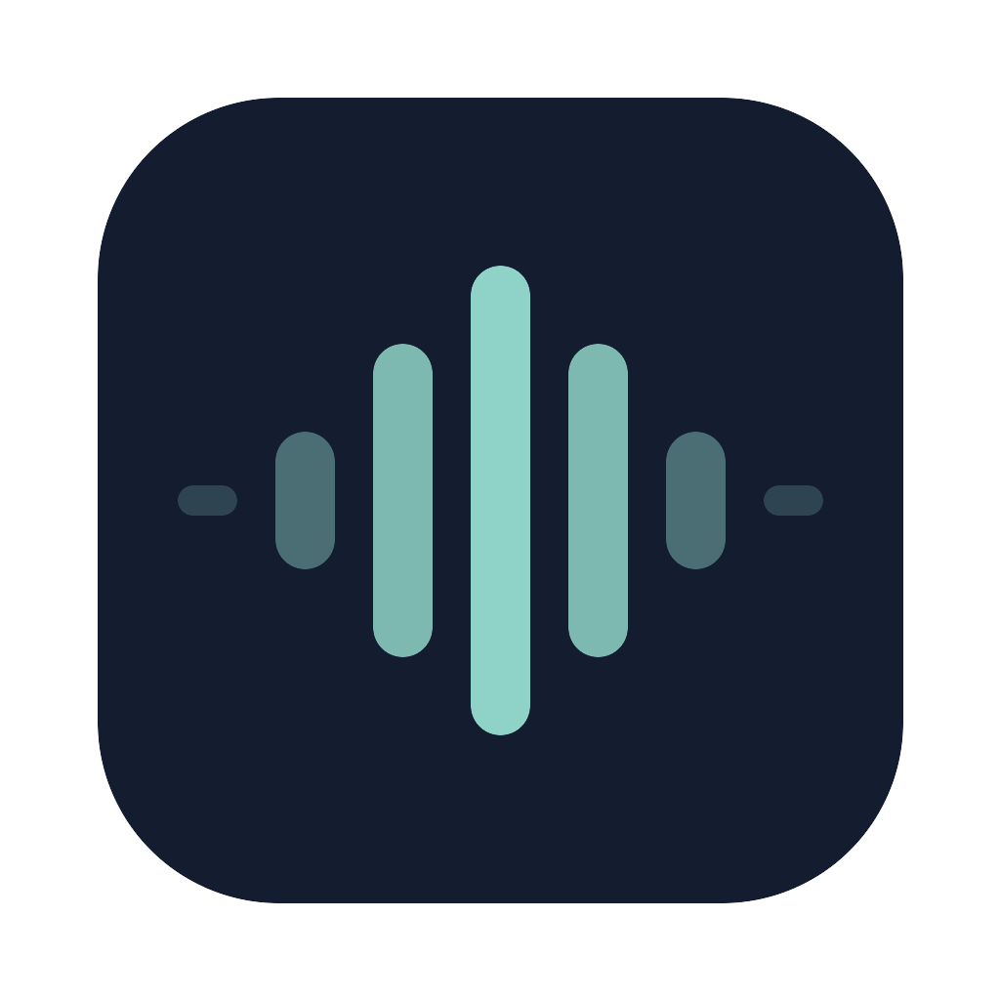

<p align="center">
  
</p>

<h1 align="center">Stillmic</h1>

<p align="center">
  <strong>Background noise removal for your Mac's microphone.</strong><br>
  Free, open source, and light enough to leave running. Your audio stays on your Mac.
</p>

<p align="center">
  <a href="https://stillmic.robin.build"><strong>stillmic.robin.build</strong></a>
</p>

<p align="center">
  <a href="https://github.com/robin-liquidium/stillmic/releases/latest"></a>
  <a href="LICENSE"></a>
  
</p>

Stillmic adds a microphone called **Stillmic** to your Mac. Pick it in Zoom, Meet, Slack or any other app, and they hear your voice with the keyboard, fan and street taken out. It runs the [DeepFilterNet3](https://github.com/Rikorose/DeepFilterNet) model locally, with no account and nothing sent anywhere.

## Why Stillmic?

- **Light:** the model is hand-ported to C with no machine learning framework. See the numbers below.
- **Idle means idle:** the noise engine only runs while an app is using the Stillmic mic. Otherwise it's asleep, measured at 0.0% CPU.
- **Private:** audio is processed on your Mac and never stored or sent. There are no analytics.
- **Simple:** a menu bar icon with on/off, a mode, and a mic picker.

## Install

1. Download [`Stillmic.dmg`](https://github.com/robin-liquidium/stillmic/releases/latest/download/Stillmic.dmg).
2. Drag Stillmic into Applications and open it.
3. Choose **Install** when Stillmic offers to add its mic, or use **Install Stillmic Mic…** in the menu bar icon. macOS asks for your password, and all audio on your Mac stops for a moment. Reload any browser tabs that go silent.
4. Select **Stillmic** as the microphone in your call app.
5. Allow microphone access when macOS asks.

**Requirements:** macOS 15 or later on Apple Silicon.

Stillmic starts at login by default, because the Stillmic mic is silent while the app isn't running. You can turn that off in the menu.

## Modes

| Mode | What it does |
|---|---|
| **Standard** | The default. Smoother voice. |
| **Aggressive** | Cuts harder between words and uses less CPU in a quiet room, but can make your voice sound more processed. |

Switch from the menu without restarting anything. Which one sounds better varies by voice and microphone, so try both.

## How light is it?

Measured on one M4 Pro on battery. The live CPU figures below are percent of one core.

| | Stillmic |
|---|---|
| CPU during a real call, Standard mode | about 6–10% |
| Memory during a real call | about 23 MB |
| CPU when no app is using the mic | 0.0% |
| Latency, mic to app, including the model's 30 ms | about 80 ms |

macOS's own audio service (`coreaudiod`) uses CPU on top of that, about 7–15% in testing.

The engine matches the official DeepFilterNet implementation to within a couple of 16-bit steps in its Aggressive mode, and that's checked by `swift test`.

## Privacy and permissions

Stillmic has no network code of its own. Its only network activity is checking for and downloading updates through Sparkle.

- **Microphone:** to read your real mic. It's only open while an app is using the Stillmic mic.
- **Administrator password:** only to install, update or remove the virtual mic, which lives in `/Library/Audio/Plug-Ins/HAL`.

## FAQ

### Does it clean up other people's audio on a call?

No. It only cleans your microphone.

### Why does my mic go silent if I quit the app?

The Stillmic mic only carries what the app gives it. Quit the app and it plays silence, never old audio. Select your normal mic if you want to stop using Stillmic.

### Can I use Bluetooth earbuds as the mic?

You can pick them in the menu, but this hasn't been tested much yet. Using a Bluetooth mic usually drops the earbuds into lower-quality call audio, so a built-in or USB mic will generally sound better.

### How do I remove it?

Choose **Uninstall Stillmic Mic…** from the menu, quit, then delete the app.

<!-- release:start -->
### Latest release: 0.1.0

- First release: real-time microphone noise removal for any Mac app, running entirely on your Mac.
- Standard and Aggressive modes, switchable from the menu bar.
- The virtual mic installs from the menu, and audio only runs while an app is using it.
<!-- release:end -->

## Build from source

```sh
git clone https://github.com/robin-liquidium/stillmic.git
cd stillmic
swift test
script/build_and_run.sh --build
```

`script/build_and_run.sh` with no flag also replaces and launches `/Applications/Stillmic.app`. Install the virtual mic from the app's menu. Release packaging and notarization are in [RELEASING.md](RELEASING.md).

```
mic -> Core Audio callback -> DeepFilterNet3 (C) -> ring buffer -> Stillmic driver -> your app
```

The website is in `website/`, built with Astro and deployed as a Cloudflare Worker. Use `bun run lint`, `bun run check` and `bun run fmt` there.

## Credits

Stillmic began as a fork of [NoNoise-Mac](https://github.com/ivalsaraj/NoNoise-Mac) by ivalsaraj, which itself grew from [MetalVoice](https://github.com/Ghostkwebb/MetalVoice) by Ghostkwebb. The idea of a menu bar app feeding a virtual mic comes from them, and the driver in `Driver/` is NoNoise-Mac's, renamed. The app and audio path have since been rewritten.

Noise removal is [DeepFilterNet](https://github.com/Rikorose/DeepFilterNet) by Hendrik Schröter, using its official DeepFilterNet3 weights under the MIT license. Updates use [Sparkle](https://sparkle-project.org). Full notices are in [THIRD_PARTY_NOTICES.md](THIRD_PARTY_NOTICES.md).

Stillmic isn't affiliated with any of these projects.

## License

[MIT](LICENSE)
